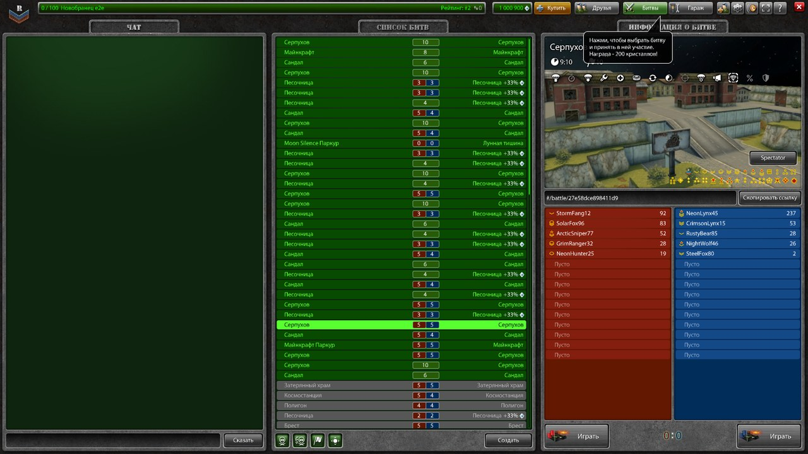
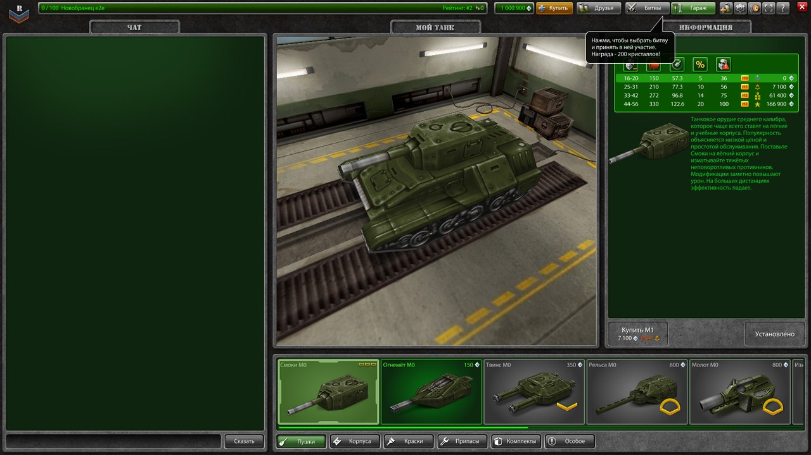
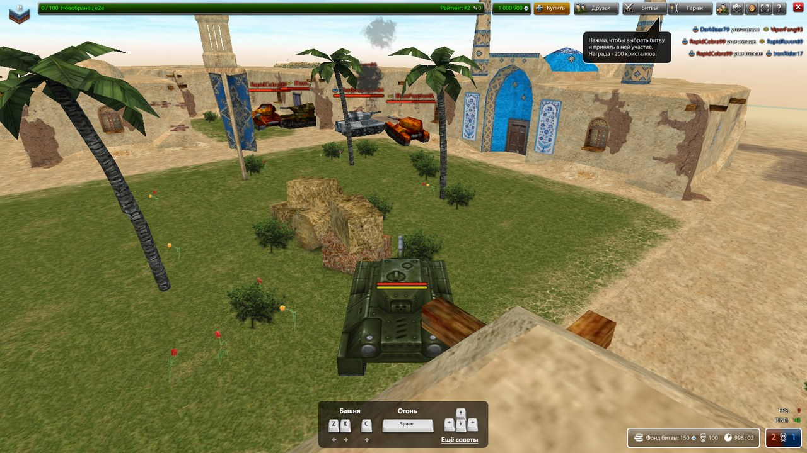

# Tanki Flashback

Сервер для старого клиента танков и браузерный клиент к нему на патченом Ruffle: игра, которая
жила на Flash, снова запускается — в браузере, без установки AIR.

> **English, in short.** Tanki Flashback is a hobby reimplementation of the server side for an old
> Flash tank game, plus a browser client built on a patched [Ruffle](https://ruffle.rs). This is a
> fan, noncommercial project, not affiliated with or endorsed by any rights holder. **No game
> resources, no game client and no decompiled client code are distributed here** — the repository
> holds only server code, tooling and patches. Licensed under
> [PolyForm Noncommercial 1.0.0](LICENSE). Docs are in Russian.

## Дисклеймер

Фанатский некоммерческий проект, сделанный для себя и друзей. Он не связан с правообладателями
оригинальной игры, не одобрен ими и ничего им не принадлежащего не распространяет.

Товарные знаки, игровой клиент, игровые ресурсы и художественное оформление принадлежат их
правообладателям. **В этом репозитории их нет** и добавлять их сюда не нужно. Чтобы получить
играбельный стенд, ресурсы и клиент придётся достать самостоятельно — как именно, написано в
разделе [Игровые ресурсы](#игровые-ресурсы).

## Как это выглядит

Снято в браузере: Chrome, патченый Ruffle, локальный стенд с ботами. Интерфейс и модели — из
оригинального клиента, в репозитории их нет (см. [Чего внутри нет](#чего-внутри-нет)).

| | |
|---|---|
|  |  |
| Лобби: список битв, чат, панель битвы | Гараж: превью танка рисуется через Stage3D |



Бой с ботами на «Иране»: они ездят по рельефу с наклоном корпуса по нормали опоры,
стреляют, держат строй и захватывают точки — пустой сервер всё равно живой.

## Что внутри

- **Сервер** на TypeScript: протокол, аутентификация, лобби, гараж, магазин, бои со всеми
  режимами, кланы, чат с командами, квесты, достижения, рейтинговый подбор, веб-панель, админка.
- **Боты** с эмуляцией клиентской физики: посадка на рельеф по нормали опоры, наклон корпуса,
  стрельба, движение по карте. Нужны, чтобы бой был живым на пустом сервере.
- **Ресурсный сервер**: отдаёт клиенту `config.xml`, SWF и игровые ресурсы, подменяет
  телеметрию заглушкой, обслуживает публичные профили и подтверждение почты.
- **Браузерный клиент**: страница-обёртка над Ruffle плюс 56 патчей к самому Ruffle, без которых
  игра либо не рисуется, либо идёт 15 кадров в секунду.
- **Патчи клиентского SWF**: правки поверх оригинального `library.swf` — потолок FPS,
  множитель разрешения, кнопка веб-панели, счётчик ботов и другие.
- **Инструменты разбора SWF/ABC** на Python и заметки по протоколу — то, из чего выросла
  серверная реализация.
- **Вьюеры** карт, коллизий и скайбоксов, нагрузочные и soak-тесты.

## Чего внутри нет

| Чего нет | Почему | Что делать |
|---|---|---|
| `server/resources/` — игровые ресурсы: модели, текстуры, карты, звуки, `.tara` | чужая собственность | [сборка в релизе](#быстрый-старт) или [свои файлы](#игровые-ресурсы) |
| игровой клиент (`library.swf`, `Loader.swf`, `Prelauncher.swf`) | чужая собственность | там же |
| AIR-сборка десктопного клиента с рантаймом Adobe | рантайм Adobe не распространяется — и не нужен: игра работает в браузере | — |
| декомпилированный AS3 официального клиента | чужой код | инструменты в `client-research/tools/` разберут ваш файл |
| собранный Ruffle (`server/webclient/ruffle-local/`) | артефакт сборки на 15 МБ | [сборка в релизе](#быстрый-старт) или [`ruffle-patches/README.md`](ruffle-patches/README.md) |
| вендоренный исходник Ruffle | вместо него 56 патчей и закреплённый коммит апстрима | там же |
| `RABCDAsm` | сторонний бинарник под GPL-2.0 | [Патчи клиента](#патчи-клиента) |
| `server/.env` | конфигурация с доступами | скопировать `server/.env.example` |

Сам репозиторий весит 4 МБ и собирается без ресурсов: `npm run build` просто предупредит,
что ресурсов нет, а сервер поднимется и будет отвечать — но игры не будет, клиенту нечего
загружать. Чтобы поиграть, нужны два архива из [релиза](https://github.com/SteepMans/tanki-flashback/releases/latest)
— см. [Быстрый старт](#быстрый-старт).

## Архитектура

```
                        ┌──────────────────────────────────────────┐
  браузер               │  страница /web (webclient/index.html)    │
  ──────────────────────│  Ruffle (wasm) + Prelauncher.swf         │
                        └───────┬──────────────────────┬───────────┘
                         HTTP   │                      │  flash.net.Socket
                                │                      │
                        ┌───────▼───────┐      ┌───────▼───────────┐
                        │ ресурсный     │      │ websockify        │
                        │ сервер :9999  │      │ :1338 → TCP :1337 │
                        │ config.xml    │      └───────┬───────────┘
                        │ SWF, ресурсы  │              │
                        │ /panel, /web  │              │
                        │ профили, почта│              │
                        └───────┬───────┘              │
                                │                      │
  AIR-клиент ───────────────────┘                      │ (десктоп идёт сюда напрямую)
                                                       │
                        ┌──────────────────────────────▼───────────┐
                        │  игровой сервер :1337                    │
                        │  протокол, лобби, бои, гараж, боты       │
                        └───────┬──────────────────────┬───────────┘
                                │                      │
                        ┌───────▼───────┐      ┌───────▼───────┐
                        │  MySQL 8      │      │ админка :7777 │
                        └───────────────┘      └───────────────┘
```

- **Сервер** — Node 22, TypeScript, сырой TCP через `net`. Тело пакета скрембится
  самомодифицирующимся XOR-потоком (обфускация, не шифрование: ключ уходит клиенту открытым
  текстом) — `server/src/core/security/security.service.ts`.
- **База** — MySQL 8 через TypeORM. MongoDB осталась только в скрипте разового переноса.
- **Ресурсный сервер** — Express на отдельном порту. Тот же origin, что и SWF, поэтому CORS не
  нужен. Отдаёт `.wasm` с правильным MIME, иначе streaming-компиляция в браузере не работает.
- **Браузер** не умеет сырой TCP. Ruffle при вызове `flash.net.Socket` ищет подходящий
  `socketProxy` и туннелирует поток в WebSocket, а `websockify` разворачивает его обратно в TCP.
  Байты не трогаются, поэтому формат кадра остаётся прежним и клиент патчить не нужно.
- **Генерация** — `npm run build:gen` раскладывает `resources/` в `.resource/` по
  клиентской схеме путей (crc-id + восьмеричный таймстамп версии) и генерирует в `src/generated/`
  карты зависимостей, данные боя и коллизии.

## Требования

- **Node 22** (проверено на 22.14) и npm 7+
- **MySQL 8** — проще всего в Docker
- **Python 3** с `websockify` — только для браузерного клиента (`pip install websockify`)
- **Chrome** — только для e2e и soak-тестов
- для сборки Ruffle: Rust, `wasm-bindgen-cli` 0.2.120, JDK, опционально `wasm-opt` —
  см. [`ruffle-patches/README.md`](ruffle-patches/README.md)
- для патчей клиентского SWF: [RABCDAsm](https://github.com/CyberShadow/RABCDAsm)

## Быстрый старт

```bash
git clone https://github.com/SteepMans/tanki-flashback.git
cd tanki-flashback/server
```

**1. Игровые данные.** Два архива из
[последнего релиза](https://github.com/SteepMans/tanki-flashback/releases/latest) — всё, чего
нет в репозитории. Распакуйте оба в `server/`:

| Архив | Что внутри | Размер |
|---|---|---|
| `tanki-flashback-resources-*.zip` | `resources/` — модели, текстуры, карты, звуки, локали и SWF клиента | 267 МБ |
| `tanki-flashback-webclient-*.zip` | собранный патченый Ruffle и патченый `library.swf` | 7 МБ |

Без них придётся доставать ресурсы самому (см. [Игровые ресурсы](#игровые-ресурсы)) и собирать
Ruffle из исходников (см. [`ruffle-patches/README.md`](ruffle-patches/README.md)).

**2. База.** Порт 33306, а не 3306: на Windows 3306 часто попадает в диапазон, зарезервированный
Hyper-V (`netsh interface ipv4 show excludedportrange protocol=tcp`), и контейнер на нём не
стартует.

```bash
docker run -d --name tanki-mysql -p 33306:3306 \
  -e MYSQL_ROOT_PASSWORD=<пароль> -e MYSQL_DATABASE=letanki \
  -v tanki-mysql-data:/var/lib/mysql --restart unless-stopped mysql:8.0
```

Схему сервер приводит к сущностям сам при старте — миграции накатывать не надо.

**3. Конфигурация.**

```bash
cp .env.example .env
# поправить MYSQL_PASSWORD, остальное для локального стенда годится как есть
```

**4. Зависимости и сборка.**

```bash
npm install
npm run build:gen    # разложить ресурсы, сгенерировать данные боя и коллизии
```

**5. Запуск.**

```bash
npm run dev -- --no-build     # разработка
# или
npm run build && npm start    # как в бою
```

Два подвоха, на которые иначе уходит время:

1. `npm run dev` без флага задаёт интерактивный вопрос про сборку ресурсов. Из неинтерактивной
   оболочки вопрос не виден, и процесс просто висит. Всегда передавайте `--build` или `--no-build`.
2. Сервер поднимает отладочную консоль на stdin. Если stdin закрыт (запуск в фоне), консоль сразу
   получает EOF и гасит процесс сообщением `Exiting server...`. Держите stdin открытым:
   `tail -f /dev/null | npm run dev -- --no-build`.

Порты после старта: `1337` игра, `9999` ресурсы, `7777` админка, `4607` публичные профили.
Проверить без клиента:

```bash
curl http://localhost:9999/health
curl http://localhost:9999/config.xml    # должен отдать address и port игрового сервера
```

**6. Браузерный клиент.**

```bash
python -m websockify 1338 127.0.0.1:1337
# открыть http://localhost:9999/web/
```

## Игровые ресурсы

Этот раздел — для тех, кто собирает дерево ресурсов сам или добавляет своё. Если нужно
просто запустить стенд — возьмите архивы из [релиза](https://github.com/SteepMans/tanki-flashback/releases/latest),
см. [Быстрый старт](#быстрый-старт).

Структура такая:

| Что | Куда | Чем |
|---|---|---|
| `library.swf`, `Loader.swf`, `Prelauncher.swf`, `hardware.swf`, `software.swf`, `TanksErrorScreen.swf` | `server/resources/` | из своей установленной копии клиента |
| модели, текстуры, карты, звуки, `.tara` | `server/resources/<тип>/<id>/v<версия>/` | `npm run download-resource`, см. ниже |
| локали `localized.data_*` | `server/resources/` | оттуда же |

Схема каталога — `<тип>/<путь>/v<версия>/<файлы>`, например
`resources/hull/hunter/m0/model/v1/object.3ds`. Номер версии локальный: `build:resources`
пересчитывает id сам (crc от пути), на официальные id он не опирается.

Два скрипта помогают, если у вас есть доступ к зеркалу ресурсов и описатель нужного ресурса
(`idhigh`, `idlow`, `versionhigh`, `versionlow`, `type` — их видно в пакете `LoadDependencies`):

```bash
# адрес зеркала не входит в репозиторий — задайте RESOURCE_MIRROR в .env или --base
ts-node scripts/downloadResource.ts --dest=clan/emblem --idlow=11805 --vhigh=413 --vlow=3234669125 --type=10
npm run extract:skyboxes
```

После того как файлы на месте:

```bash
npm run build:gen
```

Если ресурсов нет, `build:gen` предупредит и сгенерирует пустые модули — сборка и тесты проходят,
но клиенту нечего загружать.

## Конфигурация

Всё через `server/.env`, полный список с комментариями — в `server/.env.example`.

| Переменная | По умолчанию | Про что |
|---|---|---|
| `PORT` | `1337` | игровой TCP-порт |
| `RESOURCE_PORT` | `9999` | HTTP-порт ресурсов, `/web`, `/panel`, профилей |
| `ADMIN_PORT` | `7777` | админка |
| `PROFILE_PORT` | `4607` | публичные профили |
| `MYSQL_HOST`, `MYSQL_PORT`, `MYSQL_USER`, `MYSQL_PASSWORD`, `MYSQL_DATABASE` | localhost:33306 | база; либо одна строка `MYSQL_URL` |
| `DB_SYNC` | включено | `0` — не приводить схему к сущностям при старте |
| `SERVER_HOST` | `localhost` | публичный хост: ссылки на профиль, почта, реферальная ссылка |
| `WEBPANEL_URL` | `http://127.0.0.1:9999/panel` | адрес веб-панели, который сервер сообщает клиенту |
| `RESOURCE_MIRROR` | нет | зеркало для скриптов выкачивания ресурсов |
| `EMAIL_USER`, `EMAIL_PASSWORD` | нет | SMTP; без них подтверждение почты и сброс пароля выключены |
| `BOT_BATTLES`, `BOTS_PER_BATTLE` | включено, 4 | боты |
| `BATTLE_RANK_LIMITS` | снято | `map` — вернуть исходные ограничения карт по званиям |

Игровая конфигурация, которую сервер кладёт в базу при первом старте (инвайт-коды, лимиты чата,
магазин), — `server/src/config/initial-config.json`.

Админка: `http://localhost:7777/`. Логин — аккаунт с правами стаффа, пароль не зашит в код; роль
выдаётся командой `npm run set-role`.

## Патчи клиента

Оригинальный `library.swf` правится на уровне ABC: `scripts/patch-client.js` разбирает SWF
через RABCDAsm, применяет патчи из `scripts/patches/` и собирает обратно.

Скачайте [RABCDAsm](https://github.com/CyberShadow/RABCDAsm/releases) и распакуйте в
`server/tools/rabcdasm/` (нужны `abcexport`, `rabcdasm`, `rabcasm`, `abcreplace`) либо передайте
путь через `--rabcdasm`.

```bash
npm run patch:list        # список патчей
npm run patch:client      # десктопная сборка, деплой в .resource/
npm run patch:webclient   # браузерная сборка в webclient/library.swf
npm run patch:deploy      # только деплой уже собранного
```

Три патча ставятся только в браузерную сборку: `browser-nostorage` (под Ruffle
`SharedObject.flush()` бросает Error #2130 и обрывает догрузку ресурсов), `browser-fps-slider`
(потолок ползунка частоты кадров с 60 до 120) и `browser-render-scale` (флажок «Чёткая отрисовка
x2»). Десктопу они не нужны, а без кэша ресурсов он качал бы их заново каждый запуск.

## Патчи Ruffle

Браузерный клиент работает только на патченом Ruffle. 56 патчей и инструкция по сборке —
в [`ruffle-patches/README.md`](ruffle-patches/README.md):

```bash
./ruffle-patches/fetch-and-patch.sh       # клон апстрима на закреплённом коммите + git am
cd ruffle-src/web && npm install && npm run build
cp -r packages/selfhosted/dist/. ../../server/webclient/ruffle-local/
```

## Деплой

Сервер запускается под [pm2](https://pm2.keymetrics.io/) по `server/ecosystem.config.js`:

```bash
cd server
npm run build
pm2 start ecosystem.config.js
pm2 logs letankiserver
```

`start.js` — не сам сервер, а супервизор: он поднимает сервер дочерним процессом и решает, что
делать, когда тот завершился. Код выхода `75` означает «перезапусти меня» (кнопка в админке или
плановый перезапуск раз в сутки) — супервизор сразу поднимает новый процесс; `0` — настоящая
остановка по SIGTERM; любой другой код — падение, после короткой паузы перезапуск.

Браузерному клиенту за HTTPS нужен один путь в обратном прокси. Страница считает, что
WebSocket-мост живёт на `wss://<тот же хост>/ws`, кроме локальной разработки по HTTP, где он
берётся напрямую с `ws://<хост>:1338`. Пример для nginx:

```nginx
location /ws {
    proxy_pass http://127.0.0.1:1338;
    proxy_http_version 1.1;
    proxy_set_header Upgrade $http_upgrade;
    proxy_set_header Connection "upgrade";
    proxy_read_timeout 1h;
}
```

`websockify` держите отдельной службой: `python -m websockify 1338 127.0.0.1:1337`.

## Разработка и тесты

```bash
npm test                   # юнит-тесты и e2e боёв на node:test
npm run stress             # нагрузка: толпа клиентов в бою
npm run targets            # тестовые клиенты-мишени
npm run set-role           # выдать роль аккаунту
npm run tara               # распаковать/собрать .tara
```

`npm test` проходит без игровых ресурсов: тесты коллизий и рельефа данные мокают.

Браузерные тесты требуют Chrome, поднятый сервер, мост и тестовый аккаунт
(`npx tsx scripts/e2e-account.ts`):

```bash
node webclient/e2e.js --battle --shot    # вход, гараж, бой, клавиши, выход, повторный вход
node webclient/garage.js                 # гараж с покадровыми снимками превью
node webclient/settings.js               # окно настроек
node webclient/smoke.js                  # страница вообще поднялась
node webclient/soak.js --minutes 15      # длинный бой: что копится со временем
node webclient/soak.js --rounds 5        # пять заходов в бой подряд
```

`soak.js` снимает замеры движка, размер линейной памяти WASM (в ней живут все объекты игры,
поэтому её рост — прямой признак утечки на стороне клиента), число узлов страницы и, с
`--methods`, число вызовов каждого горячего метода в секунду. Растущие вызовы у метода означают
растущую коллекцию, по которой он бегает.

Диагностика в браузере: счётчик поверх игры (F8 прячет, `?stats=0` отключает), флаги в консоли
`window.ruffleTraceDraws`, `window.ruffleTraceUploads`, `window.ruffleDrawLimit`,
`window.ruffleNoCache`. Подробности — `server/webclient/README.md`.

## Структура

```
server/
  src/
    core/            протокол, кодеки, скрембл
    features/        игровые модули: battle, garage, lobby, chat, clan, shop, admin, webpanel
      battle/bot/    боты: ИИ, физика, посадка на рельеф
    config/          игровые данные и конфигурация
    maps/            загрузчики данных карт и коллизий (сами данные генерируются)
    generated/       генерируется build:gen, в репозиторий не входит
    server/          сетевой слой: игровой, ресурсный, админка, профили
    shared/          модели, сервисы, перечисления
  scripts/           сборка ресурсов и карт, патчи клиента, выкачивание, нагрузка
    patches/         патчи клиентского SWF
  test/              тесты
  webclient/         браузерный клиент и Playwright-тесты
  webpanel/          веб-панель внутри игры
  tools/             вьюеры карт, коллизий, скайбоксов
  resources/         игровые ресурсы — в репозиторий не входят
ruffle-patches/      56 патчей к Ruffle и инструкция сборки
client-research/
  tools/             парсер SWF/ABC и дизассемблер AVM2 на Python
  README.md           заметки по протоколу и цепочке загрузки
```

## Кредиты

Серверная часть выросла из [ProTanki-Server-2.0](https://github.com/magister1o) (MIT), та — из
[letanki/server](https://github.com/letanki/server) Данило Палмейры. Браузерный клиент работает на
[Ruffle](https://ruffle.rs) (MIT OR Apache-2.0). Полный список с лицензиями — [`CREDITS.md`](CREDITS.md).

## Лицензия

[PolyForm Noncommercial 1.0.0](LICENSE) — можно запускать, изучать, менять и делиться для любых
некоммерческих целей; нельзя использовать коммерчески.

Части дерева пришли из других проектов и остаются под своими лицензиями: `server/` происходит от
MIT-кода (`server/LICENSE` на месте), `ruffle-patches/` — под лицензией Ruffle
(`ruffle-patches/LICENSE`). Подробно — в [`CREDITS.md`](CREDITS.md).
